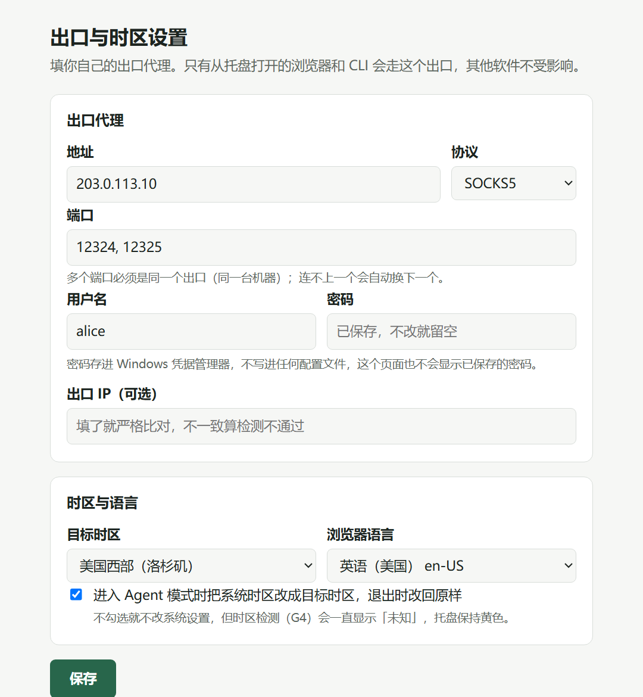

<p align="center">
  
</p>

<p align="center">
  <a href="https://github.com/zxs4KHf/agent-egress-controller/actions/workflows/ci.yml"></a>
  <a href="https://github.com/zxs4KHf/agent-egress-controller/releases"></a>
  
  <a href="LICENSE"></a>
</p>

用 Claude Code、Codex 或浏览器里的 AI 时，你可能希望它们稳定走同一个出口，而电脑上其他软件照常直连。手动配代理容易漏：浏览器走了出口，DNS 没走；IP 换了，时区还是本地；某个站点悄悄分流到了别的出口。

Agent 出口控制器把这件事收进一个托盘图标：**从托盘打开的浏览器和 CLI 走你配置的出口，系统时区跟着出口对齐，每一项都实际检测并附上证据；用完一键退出，改过的设置原样恢复。** 它不改系统代理，不碰其他程序。

<p align="center">
  
</p>
<p align="center"><sub>首次运行自动打开的设置页（只在本机 127.0.0.1 打开）。密码直接存进 Windows 凭据管理器，页面不回显。（示例数据）</sub></p>

## 它怎么工作

<p align="center">
  
</p>

- **只给 Agent 用的出口**：程序在本机起一个代理内核（[mihomo](https://github.com/MetaCubeX/mihomo)）和一个 relay。只有从托盘打开的浏览器（独立配置目录，不动你平时的浏览器数据）和终端里的 Claude Code / Codex 会指向它。
- **多端口自动切换**：同一个出口的多个端口组成候选池。连不上就换下一个，有冷却、并发上限和拨号预算，全部失败时如实报错，不伪造响应。
- **改之前先拍快照**：进入时记录系统时区等设置，退出时逐项改回并读回确认。如果发现别的程序改过了，就保留现状并告诉你，不硬覆盖。
- **有证据才算通过**：拿不到证据的检测项显示「未知」，不当作通过。托盘只有在硬门槛全部通过时才变绿。

## 检测什么

| 硬门槛 | 通过的条件 |
| --- | --- |
| G1 出口 | 经代理访问目标站看到的出口 IP，和本机直连的 IP 不同；填了预期 IP 就严格比对 |
| G2 目标站 | 每个目标站点（默认 claude.ai、www.anthropic.com、chatgpt.com）都能连上，而且走的是同一个出口 |
| G3 DNS | 目标域名是由内核按名字代办解析的，没有经过本机 DNS |
| G4 时区 | 系统时区和浏览器里 `Intl` 报告的时区都等于目标时区 |
| G5 语言 | 每个打开的浏览器的语言和 Accept-Language 符合设置 |

另有只读信号，只提示、不影响就绪：出口 ASN、延迟、WebRTC 是否暴露本机 IP、Canvas/WebGL、Cookie 开关、非目标网站的出口、时区由谁设置。**不打 0–100 的「纯净度」分，也不伪造指纹。**

每个没通过或「未知」的项目都能在托盘里一键「复制排查提示词」：一段固定格式、已去掉密码的说明，粘贴给任意 AI 助手就能接着排查。程序不会自动发送任何东西。

## 5 分钟上手

**需要：** Windows 10/11；本机已装 Edge 或 Chrome；一个你自己的出口代理（SOCKS5 或 HTTP，地址、端口，有账号就带上）。

1. 到 [Releases](https://github.com/zxs4KHf/agent-egress-controller/releases) 下载 `AgentEgressController-0.1.0-portable.zip`，解压到任意文件夹。
2. 双击 `aec-tray.exe`。程序没有签名，Windows 可能提示「已保护你的电脑」，点「更多信息 → 仍要运行」。
3. 自动打开的设置页里填出口和目标时区，保存。想让程序改系统时区，就勾选那一项。
4. 右下角托盘圆点（可能藏在「^」里）→「进入 Agent 模式」。等圆点变绿，从菜单打开 Edge、Chrome、Claude Code 或 Codex。
5. 用完点「退出 Agent 模式」。浏览器会被关掉，时区改回，代理停止。

| 圆点颜色 | 含义 |
| --- | --- |
| 灰 | 日常模式，什么都没改 |
| 绿 | 硬门槛全部通过 |
| 黄 | 有检测没通过或正在处理，看「查看检测结果」 |
| 红 | 上次没有正常恢复，菜单里有「恢复」 |

数据（设置、检测结果、日志、快照）放在解压目录的 `data\` 里；密码在凭据管理器里，名字以 `AgentEgressController:` 开头。

## 它不做什么

- 不改系统代理：其他软件照常联网（以后作为可选项加入，见[路线图](docs/ROADMAP.md)）。
- 不用 TUN、不改路由和防火墙、不装服务、不需要管理员权限。
- 本机上如果有别的程序也在改时区（比如另一个代理工具的托盘），程序就不去动时区，并在检测结果里说明原因。
- 不结束不是它启动的进程；终端窗口由你自己关。
- 不提供出口，也不内置任何人的出口：你需要自己有一个。

## 已知限制

`0.1.0` 是预览版：只有便携 zip，没有安装包和开机自启；系统时区的真实修改和真实出口端到端还在收集更多机器上的验证。遇到问题请开 [Issue](https://github.com/zxs4KHf/agent-egress-controller/issues/new/choose)，附上「复制排查提示词」的内容（不想公开 IP 就先打码）。

## 参与开发

```bash
git clone https://github.com/zxs4KHf/agent-egress-controller.git
cd agent-egress-controller
cargo test
cargo run -p aec-tray
```

- [CONTRIBUTING.md](CONTRIBUTING.md)：开发流程和不接受的改动。给 AI Agent 的速查在 [AGENTS.md](AGENTS.md)。
- [docs/SPEC.md](docs/SPEC.md)：完整行为规格。[CONTEXT.md](CONTEXT.md)：术语表。[docs/adr/](docs/adr/)：关键取舍。
- [docs/ROADMAP.md](docs/ROADMAP.md)：路线图。[CHANGELOG.md](CHANGELOG.md)：更新记录。
- 安全问题请按 [SECURITY.md](SECURITY.md) 私下报告。

## 许可证

[GPL-3.0](LICENSE)。发布包里附带的 `aec-mihomo.exe` 是 [mihomo](https://github.com/MetaCubeX/mihomo) v1.19.31 的官方 Windows 可执行文件（未修改），同样按 GPL-3.0 分发。
