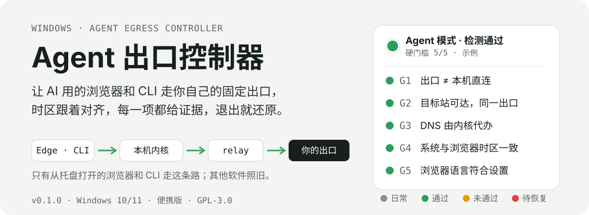
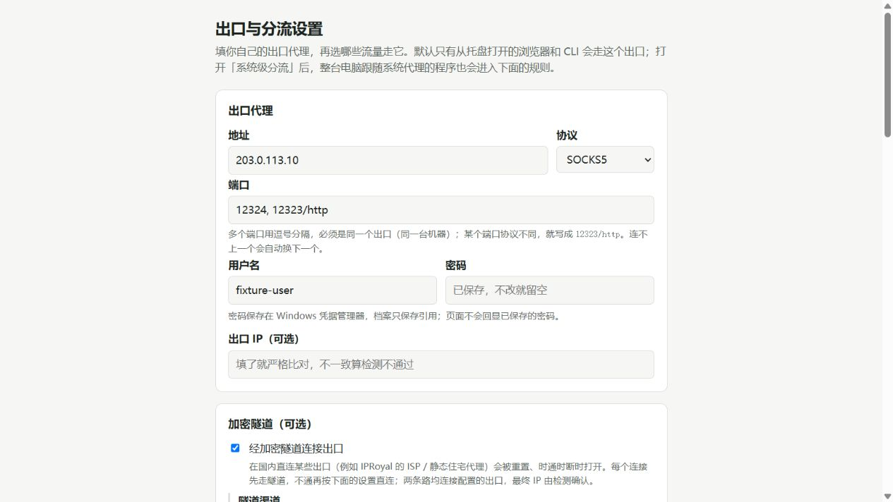
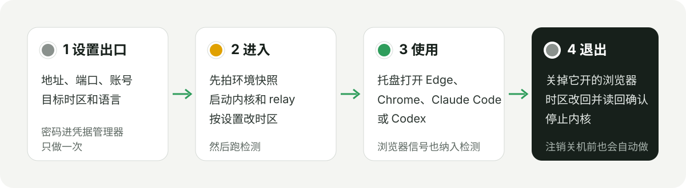

<p align="center">
  
</p>

<p align="center">
  <a href="https://github.com/zxs4KHf/agent-egress-controller/actions/workflows/ci.yml"></a>
  <a href="https://github.com/zxs4KHf/agent-egress-controller/releases"></a>
  
  <a href="LICENSE"></a>
</p>

用 Claude Code、Codex 或浏览器里的 AI 时，你可能希望它们稳定走同一个出口，而电脑上其他软件照常直连。手动配代理容易漏：浏览器走了出口，DNS 没走；IP 换了，时区还是本地；某个站点悄悄分流到了别的出口。

Agent 出口控制器把这件事收进一个托盘图标：从托盘打开的浏览器和 CLI 使用你配置的出口，按需对齐系统时区，逐项检测并给出证据，退出时按快照恢复。默认只影响显式启动的入口；需要让遵循 Windows 系统代理的桌面应用使用同一套规则时，可开启系统代理接管。真实全局写入始终受接管门保护。

0.3.0 新增本机看板：托盘「打开看板」管理受保护站点、有序分流规则和到同一个 ISP 的连接路径。托盘和看板都能开关登录自启、创建桌面和开始菜单快捷方式。固定出口模式切换时允许断连，只有精确 IP 核对成功才放行。

<p align="center">
  
</p>
<p align="center"><sub>0.2.0 设置页，截图使用合成地址和账号。页面只在 127.0.0.1 打开，密码不回显；下方另有分流、系统代理和时区设置。</sub></p>

## 它怎么工作

<p align="center">
  
</p>

- **默认只给 Agent 用的出口**：本机运行 [mihomo](https://github.com/MetaCubeX/mihomo) 和 Rust relay，托盘启动的浏览器使用独立配置目录，CLI 使用子进程代理变量。可选系统代理接管让其他遵循系统代理的应用也进入这套规则。
- **隧道中转**：直接连不上 HTTP/SOCKS5 出口时，可先通过 Shadowsocks 隧道连接出口。设置页提供 [IPRoyal 官方公开中转](https://iproyal.com/integrations/how-to-use-iproyal-proxies-with-shadowrocket/) 预设，也支持自定义。中转入口不是最终出口，仍需用户自己的出口代理账号。
- **路由表作为数据**：具名出站、多层组、规则顺序和注释直接保存在档案里。可以导入 mihomo/Clash 路由表，在托盘切换 `select` 组并保存选择，无需改 Rust 代码或重新发版。
- **多端口自动切换**：同一个出口的多个端口组成候选池。连不上就换下一个，有冷却、并发上限和拨号预算，全部失败时如实报错，不伪造响应。
- **等待与流式响应**：当前源码已修复 relay 把握手超时带入传输阶段的问题，连接建立后可等待较慢的响应和流式输出间隔；拨号预算继续生效。0.2.0 发布包尚未包含此修复。
- **改之前先拍快照**：进入时记录系统时区等设置，退出时逐项改回并读回确认。如果发现别的程序改过了，就保留现状并告诉你，不硬覆盖。
- **有证据才算通过**：拿不到证据的检测项显示「未知」，不当作通过。托盘只有在硬门槛全部通过时才变绿。

## 检测什么

| 硬门槛 | 通过的条件 |
| --- | --- |
| G1 出口 | 经代理访问目标站看到的出口 IP，和本机直连的 IP 不同；填了预期 IP 就严格比对 |
| G2 目标站 | 每个目标站点（默认 claude.ai、www.anthropic.com、chatgpt.com）都能连上，而且走的是同一个出口 |
| G3 DNS | 目标域名是由内核按名字代办解析的，没有经过本机 DNS |
| G4 时区 | 系统时区和浏览器里 `Intl` 报告的时区都等于目标时区 |
| G5 语言 | 每个打开的浏览器的语言和 Accept-Language 符合设置 |
| G6 系统代理（仅开启系统接管时） | 接管门允许真实写入，且 Windows 系统代理仍指向本程序 |

另有只读信号，只提示、不影响就绪：出口 ASN、延迟、WebRTC 是否暴露本机 IP、Canvas/WebGL、Cookie 开关、非目标网站的出口、时区由谁设置。**不打 0–100 的「纯净度」分，也不伪造指纹。**

0.3.0 提供 R11「Claude 桌面版当前连接遵循分流」：关联 Windows 进程连接与本程序内核的连接表，检查实际命中的出站链。空闲、连接已关闭或证据不足就是未知；绿灯和内核探测请求不能代替桌面版流量证据。

每个没通过或「未知」的项目都能在托盘里一键「复制排查提示词」：一段固定格式、已去掉密码的说明，粘贴给任意 AI 助手就能接着排查。程序不会自动发送任何东西。

## 5 分钟上手

**需要：** Windows 10/11；本机已装 Edge 或 Chrome；一个你自己的出口代理（SOCKS5 或 HTTP，地址、端口，有账号就带上）。

1. 到 [Releases](https://github.com/zxs4KHf/agent-egress-controller/releases) 下载 `AgentEgressController-0.3.0-portable.zip`，按 `SHA256SUMS.txt` 校验后解压。
2. 双击 `aec-tray.exe`。程序没有签名，Windows 可能提示「已保护你的电脑」，点「更多信息 → 仍要运行」。
3. 设置页填自己的出口、端口和账号、目标时区。直接连接失败时启用隧道；只代理 AI 域名可选「分流」，其他流量默认直连，也可填自己的日常代理。需要修改时区或系统代理时分别勾选相应开关。
4. 托盘圆点（可能藏在「^」里）→「进入 Agent 模式」，然后从菜单打开 Edge 或 Chrome，让本地检查页回报时区、语言等证据。未打开浏览器或检查证据不足时保持黄色；全部硬门槛通过后才变绿，再开始使用 AI 服务或 CLI。
5. 用完点「退出 Agent 模式」。浏览器会被关掉，时区改回，代理停止。

| 圆点颜色 | 含义 |
| --- | --- |
| 灰 | 日常模式，什么都没改 |
| 绿 | 硬门槛全部通过 |
| 黄 | 有检测没通过或正在处理，看「查看检测结果」 |
| 红 | 上次没有正常恢复，菜单里有「恢复」 |

数据（设置、检测结果、日志、快照）放在解压目录的 `data\` 里；密码在凭据管理器里，名字以 `AgentEgressController:` 开头。

## Claude 桌面版走 ISP 出口

桌面版照常打开。在设置页开启「系统代理接管」，分流时保留 `anthropic.com`、`claude.ai`、`claude.com`、`claudeusercontent.com` 的固定出口规则（包括子域名，如 `api.anthropic.com`），放在国内分流和最终兜底之前。填入自己的 ISP 代理；直连失败时可用 IPRoyal 官方中转连接同一个出口。接管门允许后，Windows 系统代理指向本程序的 mixed-port，遵循系统代理的桌面请求使用同一张路由表。导入的自定义表保持原顺序，需要自行核对这些规则。

进入后确认 G6 通过，在 Claude 中正常使用，再点「重新检测」查看 R11。0.3.0 可单独执行 `aec-dev desktop check --json --data-dir <托盘数据目录>`，它只读，不启动或关闭 Claude。桌面接入步骤、未知原因和验收边界见 [用户指南](docs/USER-GUIDE.md#claude-桌面版接入与核验)。

R11 通过仅证明观测到的连接遵循路由，实际 ISP 身份和出口 IP 仍需结合 G1/G2 的真实证据。应用自己的代理设置、旧长连接、Node/MCP/Cowork 的独立网络路径可能忽略系统代理，不能承诺整台机器或桌面版所有子组件都经过出口；退出时恢复系统代理，不代用户关闭 Claude。

## 导入和交付给其他用户

先退出 Agent 模式，再在便携包目录运行 PowerShell：

```powershell
.\aec-dev.exe profile import .\my-routing.yaml --dry-run
.\aec-dev.exe profile verify .\my-routing.yaml
.\aec-dev.exe profile import .\my-routing.yaml
.\aec-dev.exe profile check
```

导入只替换路由表，保留出口、时区、启动入口等设置；不读取源配置的系统代理、监听端口、TUN 或 DNS 配置。凭据迁入当前用户的 Windows 凭据管理器，原 YAML 不被修改。导入前自动保存原档案备份，设置页默认「保留现有路由数据」。选择内置预设会替换整张导入表。

支持 HTTP、SOCKS5、AEAD Shadowsocks 与 `dialer-proxy`，`select` / `fallback` / `url-test` 组，以及 DOMAIN、DOMAIN-SUFFIX、DOMAIN-KEYWORD、IP-CIDR/IP-CIDR6、GEOSITE、GEOIP 和最后一条 MATCH。规则顺序、组成员顺序、健康检查和常规块列表中的规则注释保留。不支持的节点、组字段、规则或 provider 会拒绝整次导入，不会默默删掉。

给用户分发 Releases 中的全新 zip，加上不含私人凭据的路由示例与自己的服务配置说明即可。不要转发已使用的 `data\`、日志、浏览器配置目录或含密码的源 YAML。每位用户在本机保存自己的账号；`credentialRef` 不能跨机器替代密码。完整步骤见 [用户交付指南](docs/USER-GUIDE.md)。本项目是 Windows 本机出口控制器，远程 AI API 网关本身需要另外部署。

## 它不做什么

- 默认不改系统代理。开启接管后，影响遵循 Windows 系统代理的应用；自行忽略系统代理的应用需要单独配置。
- 不用 TUN、不改路由和防火墙、不装服务、不需要管理员权限。
- 本机上如果有别的程序也在改时区（比如另一个代理工具的托盘），程序就不去动时区，并在检测结果里说明原因。
- 不结束不是它启动的进程；终端窗口由你自己关。
- 不提供用户的出口账号。仓库中 IPRoyal 隧道参数是供应商官方公开预设，文档核对日期为 2026-10-12；节点实际可用性由用户网络和供应商决定。私人出口凭据不随仓库或便携包分发。[推荐规则](docs/RECOMMENDED-RULES.md) 是用户可编辑的建议。

## 已知限制

`0.3.0` 是预览版：只有 Windows x64 便携 zip，没有安装包或签名；登录自启由用户选择，默认关闭。GEOSITE/GEOIP 需要用户提供可信的 `GeoSite.dat` 和 `GeoIP.dat` 到 `bin\`；包中不附带未核实来源的数据文件，程序不自动下载。未提供时保持「国内直连」关闭；相关规则预检会明确报缺项。

已验证的范围包括本地完整链路、真实 mihomo 配置与选择恢复、固定保护阻断和重载，以及维护者旧路由表导入后的真实出口等价性；其他用户网络中的隧道可用性、Windows 10/11 普通账号的全局写入与恢复仍需实机验收。详细证据见 [0.3.0 验收记录](docs/RELEASE-0.3.0.md)。遇到问题请开 [Issue](https://github.com/zxs4KHf/agent-egress-controller/issues/new/choose)，附上已脱敏的排查提示词。

## 看板、自启与打开入口

托盘「打开看板」或 `aec-tray.exe --dashboard` 打开本机页面。选择直连、官方隧道自动选择或单个节点，改变的是 ISP 前面的第一跳；首次启用需先退出 Agent 模式并填写精确预期 IP。运行中切换路径或保存规则先阻断、断开本应用内核的连接；出口未知或不一致时保持阻断。每 30 秒巡检，证据只代表检测时刻，不能保证供应商两次巡检之间永不换 IP。

站点支持常用选项和自定义域名，规则支持类型、出站、排序和删除；GeoSite/GeoIP 建议必须存在于用户的数据文件中。受保护域名及子域名优先于普通规则，删除站点会取消其保护。新增网站只测可达性，不把未提供 trace 的网站当作出口 IP 证据。普通规则仍允许 DIRECT；这不是整机锁 IP 或 TUN。

托盘和看板的「登录时自动启动」写当前用户的一条启动项，登录后尝试进入 Agent 模式，不绕过未恢复会话或接管门。「创建桌面和开始菜单快捷方式」创建托盘、看板各两个入口；开始菜单搜索 `Agent Egress`。命令行也支持 `--enable-autostart`、`--disable-autostart`、`--create-shortcuts`。拒绝覆盖另一份安装的注册或同名快捷方式；移动、更新、卸载前先关闭自启并移除旧快捷方式。

## 参与开发

```bash
git clone https://github.com/zxs4KHf/agent-egress-controller.git
cd agent-egress-controller
cargo test
cargo run -p aec-tray
```

- [CONTRIBUTING.md](CONTRIBUTING.md)：开发流程和不接受的改动。给 AI Agent 的速查在 [AGENTS.md](AGENTS.md)。
- [docs/RECOMMENDED-RULES.md](docs/RECOMMENDED-RULES.md)：哪些域名该走固定出口、哪些不该，以及为什么。
- [docs/SPEC.md](docs/SPEC.md)：完整行为规格。[CONTEXT.md](CONTEXT.md)：术语表。[docs/adr/](docs/adr/)：关键取舍。
- [docs/ROADMAP.md](docs/ROADMAP.md)：路线图。[CHANGELOG.md](CHANGELOG.md)：更新记录。
- 安全问题请按 [SECURITY.md](SECURITY.md) 私下报告。

## 许可证

[GPL-3.0](LICENSE)。发布包里附带的 `aec-mihomo.exe` 是 [mihomo](https://github.com/MetaCubeX/mihomo) v1.19.31 的官方 Windows 可执行文件（未修改），同样按 GPL-3.0 分发。
