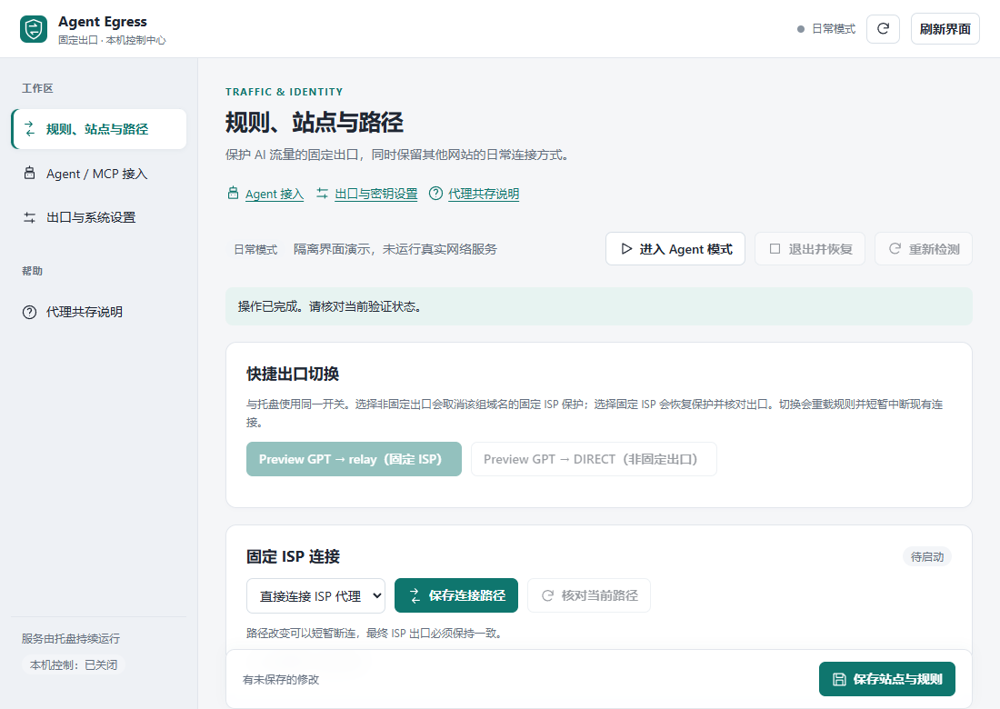

<p align="center">
  
</p>

<p align="center">
  <a href="https://github.com/zxs4KHf/agent-egress-controller/actions/workflows/ci.yml"></a>
  <a href="https://github.com/zxs4KHf/agent-egress-controller/releases"></a>
  
  <a href="LICENSE"></a>
</p>

用 Claude Code、Codex 或浏览器里的 AI 时，你可能希望它们稳定走同一个出口，而电脑上其他软件照常直连。手动配代理容易漏：浏览器走了出口，DNS 没走；IP 换了，时区还是本地；某个站点悄悄分流到了别的出口。

> 支持“沿用当前系统代理，仅选定站点固定 ISP”：Clash Verge Rev 2.5.8 默认订阅脚本持久安装/撤销、只读运行规则核对及可选 DNS/ECS 权威回证。保存规则不等于激活或已保护；由用户在 Clash 手动重新激活。全局浏览器设置当前仅支持普通 Edge，排除 Chrome / Chrome for Testing 与使用它们的指纹浏览器。公开下载以 [Releases](https://github.com/zxs4KHf/agent-egress-controller/releases/latest) 为准；推送代码不会自动升级本机网关。

**0.5.9：系统代理被改写时明确显示红色冲突。** AEC 本地接管期间，托盘与看板变红，并弹出“检测到系统代理已经被更改”的错误提醒。请正常退出 Agent 模式，关闭其他客户端的“系统代理”开关，再重新进入；无需重启 Windows。AEC 不抢回代理、不自动停服，重新检测或把端口改回去不会清除本次冲突。Agent 可读取 `aec_state.systemProxyConflict`；详见 [0.5.9 验证与回滚](docs/RELEASE-0.5.9.md)。公开下载仍以 Releases 为准。

[0.5.9 下载与更新说明](https://github.com/zxs4KHf/agent-egress-controller/releases/tag/v0.5.9)：新用户选择安装 EXE 或便携 ZIP；老用户在托盘「设置与维护 → 检查完整更新」升级。0.5.3 及之后的更新器只下载变化组件；本次含核心修复，不能只更新界面，安装前仍须确认短暂断连。旧版兼容与一次性更新器引导见[升级指南](docs/UPDATING.md)。

保留 0.5.8 的两种连接方式与 Clash 默认控制通道。在托盘“设置与维护 → 连接方式”打开设置，两项并列单选，不能同时开启。

| 选择 | 需要操作 | 连接路径 |
| --- | --- | --- |
| 1. 保留 Clash 等客户端的系统代理 | 保持系统代理开启、规则模式；在 AEC 安装选定站点规则，再到 Clash 激活并核对 | 普通网站沿用 Clash；选定站点经 Clash → AEC → 原固定 ISP |
| 2. 关闭客户端系统代理，由 AEC 本地接管 | 关闭 Clash 的系统代理开关，保留内核运行；在 AEC 配置本机上游与普通流量路由，无需修改 Clash 站点规则 | Windows 系统代理指向 AEC；固定站点 → 原 ISP，其他网站 → AEC 路由选择的本机上游 |

关闭的是 Clash 的系统代理开关，方式二的 Windows 系统代理仍由 AEC 开启并管理。两种方式都保留现有隧道、连接重试和固定身份核验；配置保存不等于运行已生效，不会静默切换旧用户的配置。普通 IP 检测网站的出口不能代替 Claude 对应路径证据。详细步骤、激活入口和切换影响见[用户指南](docs/USER-GUIDE.md#保留客户端入口与代理共存)及 [0.5.8 验收](docs/RELEASE-0.5.8.md)。

Agent 出口控制器把这件事收进一个托盘图标：从托盘打开的浏览器和 CLI 使用你配置的出口，按需对齐系统时区，逐项检测并给出证据，退出时按快照恢复。默认只影响显式启动的入口；需要让遵循 Windows 系统代理的桌面应用使用同一套规则时，可开启系统代理接管。真实全局写入始终受接管门保护。

0.5.1 提供统一风格的桌面控制中心和盾牌图标：站点搜索、规则按出站/匹配类型筛选分页、详情折叠，Agent 开关显示服务端实际状态。固定出口切换时允许断连，只有精确 IP 核对成功才放行；失败保持阻断。设置页可指定本机代理入口端口，接替已有链路时保留客户端入口。

**0.5.2 修复任务栏合组**：控制中心使用独立 Windows 任务栏标识，不再依赖启动它的 ChatGPT/Codex 等宿主的分组。看板快捷方式匹配同一标识与盾牌图标；任务栏重开只调用托盘的看板入口，不保存临时令牌。此项修复不改变分流或固定出口。升级后在托盘点「创建桌面和开始菜单快捷方式」修复旧入口。已固定的旧入口如仍有缓存，可取消固定 **Agent Egress 的旧入口**，从新的看板窗口重新固定；不需要取消固定 ChatGPT。

<p align="center">
  
</p>
<p align="center"><sub>0.5.1 控制中心，截图使用隔离合成配置，不运行真实网络服务。页面只在 127.0.0.1 打开，密码不回显。</sub></p>

## 它怎么工作

### 站点协作与浏览器环境

- 看板“固定站点协作”先展示域名、入口和改动，确认后只在 Clash 当前已注册且独占的默认脚本追加受管尾块，保留订阅、节点、系统代理。版本/进程无法核实、自定义或共享脚本、GUI DNS 接管时拒绝自动安装，仍可手动导出。不替用户决定 GPT 或 Arena 的出口。
- 安装之后由用户在 Clash 重新激活当前配置，再做只读运行核对。AEC 不调用 PUT 重载、不反复抢系统代理；规则存在、固定 ISP 身份、DNS 证据分开报告。修改站点后先撤销旧块再预览；外部编辑冲突不盲目覆盖。
- 支持 CVR 2.5.8 既有 Windows named pipe 和已认证 IPv4 loopback TCP 控制通道；不需要为了 AEC 另开 TCP controller。协作模式与旧系统接管互斥；托盘设置入口、看板和 Agent 使用同一选项。
- 受管块包括固定转发、前置 UDP 拒绝、经固定入口的局部 DoH 策略。专用入口连接受原 ISP 身份门控制；不是绕过身份门的探测端口。规则/直连模式、端口回环、同名所有权和 DNS 策略冲突都会拒绝或保持未验证。
- DNS/ECS 检测需单独同意，分别查询当前客户端解析器和显式固定入口 Google DoH，核对随机 TXT 权威回证。标准 ECS 使用零长度覆盖，不等于删除所有 ECS。报告仅覆盖本次查询，不冒充所有 Claude 域名或浏览器无泄露；日志中的错误码、动作和时间可由 Agent 读取。
- “仅 AI 浏览器”只改变 AEC 专用目录的启动参数。“全局浏览器”当前仅对普通 Edge 写有限策略，预览原值、目标与影响后确认；不会读写 Chrome、指纹 profile、Cookie 或其他项目。指纹浏览器若使用 Edge，不应应用全局范围。需要自行重开日常浏览器，AEC 不替用户关闭它。
- 浏览器设置可恢复原值，外部已改写的值不覆盖；应用失败保留恢复记录。关闭错误提示后，Agent 仍可读取错误码、操作和时间。设置保存不等于浏览器运行证据通过，尤其不能承诺整机 DNS、EDNS/ECS 或 IPv6 无泄露。
- 静态应用图标改为中性紫色，只有托盘状态色表达检测结果；托盘按“出口与分流”“检测与排查”“设置与维护”分层。

详见 [协作与环境验收](docs/SELECTIVE-COOPERATION.md) 和 [Agent 接入](docs/AGENT-INTEGRATION.md#站点协作与浏览器环境)。

**更新器保留 0.5.7 的 `update_busy` 修复与临时下载重试。** 更新中的重复请求明确提示等待，日志保留失败与重试证据供 Agent 离线读取。保留健康链路重新检测、跨日 G3 修复、独立窗口与组件增量下载；不包含管理员防绕过服务，不自动激活 Clash。详见 [0.5.7 更新器验收](docs/RELEASE-0.5.7.md)、[0.5.8 协作修复](docs/RELEASE-0.5.8.md) 与 [升级指南](docs/UPDATING.md)。

**方式二的多个本机代理上游。** 选择由 AEC 本地接管时，在控制中心「AEC 托管普通上游」管理 XxYun、Clash 等端点，并关闭其他客户端系统代理开关。上游支持面板 CRUD/检测、托盘一键选择与 MCP/HTTP；新增上游不自动替换原选择，固定站点与 ISP 身份不变。

客户端端口不是固定值：填写实际 HTTP/SOCKS5/mixed 端口，各客户端避开相同地址端口，并关闭它们的系统代理和 TUN 接管。管理器只支持免认证 loopback 上游，最多 16 个；拒绝 AEC 自环、重复端点和隧道传输出站。检测只验证固定测试站的 HTTPS，不保证 GPT 登录或所有网站可用。运行中应用配置可能短暂断连，但不退出网关；原有 DIRECT 兜底保留，不会新增直连回退。详见[用户指南](docs/USER-GUIDE.md#多个本机代理上游)与[Agent 接入](docs/AGENT-INTEGRATION.md#本机代理上游管理)。

<p align="center">
  
</p>

- **默认只给 Agent 用的出口**：本机运行 [mihomo](https://github.com/MetaCubeX/mihomo) 和 Rust relay，托盘启动的浏览器使用独立配置目录，CLI 使用子进程代理变量。可选系统代理接管让其他遵循系统代理的应用也进入这套规则。
- **隧道中转**：直接连不上 HTTP/SOCKS5 出口时，可先通过 Shadowsocks 隧道连接出口。设置页提供 [IPRoyal 官方公开中转](https://iproyal.com/integrations/how-to-use-iproyal-proxies-with-shadowrocket/) 预设，也支持自定义。中转入口不是最终出口，仍需用户自己的出口代理账号。
- **路由表作为数据**：具名出站、多层组、规则顺序和注释直接保存在档案里。可以导入 mihomo/Clash 路由表，在托盘切换 `select` 组并保存选择，无需改 Rust 代码或重新发版。
- **多端口自动切换**：同一个出口的多个端口组成候选池。连不上就换下一个，有冷却、并发上限和拨号预算，全部失败时如实报错，不伪造响应。
- **等待与流式响应**：0.3.0 起 relay 不再把握手超时带入传输阶段，连接建立后可等待较慢的响应和流式输出间隔；拨号预算继续生效。
- **改之前先拍快照**：进入时记录系统时区等设置，退出时逐项改回并读回确认。如果发现别的程序改过了，就保留现状并告诉你，不硬覆盖。
- **有证据才算通过**：拿不到证据的检测项显示「未知」，不当作通过。托盘只有在硬门槛全部通过时才变绿。

## 检测什么

| 硬门槛 | 通过的条件 |
| --- | --- |
| G1 出口 | 经代理访问目标站看到的出口 IP，和本机直连的 IP 不同；填了预期 IP 就严格比对 |
| G2 目标站 | 每个目标站点（默认 claude.ai、www.anthropic.com、chatgpt.com）都能连上，而且走的是同一个出口 |
| G3 DNS 路径 | 本轮检测请求在内核中带目标域名，并命中预期出站；不代表浏览器或整机没有 DNS 泄露 |
| G7 站点协作入口 | 协作模式另核对系统入口及 Clash 当前有序规则；实际节点端点与 DNS 策略无独立证据时保持未知，内部出口通过不能代替 |
| G4 时区 | 系统时区和浏览器里 `Intl` 报告的时区都等于目标时区 |
| G5 语言 | 每个打开的浏览器的语言和 Accept-Language 符合设置 |
| G6 系统代理（仅开启系统接管时） | 接管门允许真实写入，且 Windows 系统代理仍指向本程序 |

另有只读信号，只提示、不影响就绪：出口 ASN、延迟、WebRTC 是否暴露本机 IP、Canvas/WebGL、Cookie 开关、非目标网站的出口、时区由谁设置。**不打 0–100 的「纯净度」分，也不伪造指纹。**

0.3.0 提供 R11「Claude 桌面版当前连接遵循分流」：关联 Windows 进程连接与本程序内核的连接表，检查实际命中的出站链。空闲、连接已关闭或证据不足就是未知；绿灯和内核探测请求不能代替桌面版流量证据。

每个没通过或「未知」的项目都能在托盘里一键「复制排查提示词」：一段固定格式、已去掉密码的说明，粘贴给任意 AI 助手就能接着排查。程序不会自动发送任何东西。

## 5 分钟上手

**需要：** Windows 10/11；本机已装 Edge 或 Chrome；一个你自己的出口代理（SOCKS5 或 HTTP，地址、端口，有账号就带上）。

1. 到 [Releases](https://github.com/zxs4KHf/agent-egress-controller/releases/latest) 选择已发布版本的 `setup.exe` 安装，或下载同版本 `portable.zip` 便携运行；按同版本 SHA256 文件核对。不要把开发分支或 CI 候选当成已发布更新。
2. 安装版从开始菜单启动 Agent Egress Controller；便携版双击 `aec-tray.exe`。首次启动会打开桌面控制中心。程序没有签名，Windows 可能提示「已保护你的电脑」，点「更多信息 → 仍要运行」。若提示缺少 WebView2 Runtime，按提示从微软安装后重试。
3. 设置页填自己的出口、端口和账号、目标时区。直接连接失败时启用隧道；只代理 AI 域名可选「分流」，其他流量默认直连，也可填自己的日常代理。需要修改时区或系统代理时分别勾选相应开关。
4. 托盘圆点（可能藏在「^」里）→「进入 Agent 模式」，然后从菜单打开 Edge 或 Chrome，让本地检查页回报时区、语言等证据。未打开浏览器或检查证据不足时保持黄色；全部硬门槛通过后才变绿，再开始使用 AI 服务或 CLI。
5. 用完点「退出 Agent 模式」。浏览器会被关掉，时区改回，代理停止。

| 圆点颜色 | 含义 |
| --- | --- |
| 灰 | 日常模式，什么都没改 |
| 绿 | 硬门槛全部通过 |
| 黄 | 有检测没通过或正在处理，看「查看检测结果」 |
| 红 | 上次没有正常恢复，菜单里有「恢复」 |

数据（设置、检测结果、日志、快照）放在解压目录的 `data\` 里；密码在凭据管理器里，名字以 `AgentEgressController:` 开头。

托盘和看板提供「仅更新界面」与「检查完整更新」。**0.5.3 更新器支持真正按组件增量下载**：读取小型校验清单，比较实际文件 SHA256，仅下载有变化的组件；未变化的 mihomo 内核可跳过。确认框显示所需组件数、预计大小和完整包大小。这不是二进制字节差分，不承诺固定节省比例。仅界面更新只下载界面组件，不停止网络服务；核心更新仍需独立停服确认。取消不停止、不替换，保留用户配置、凭据和回滚备份。

**老用户升级 0.5.9：** 0.5.3–0.5.8 可从原托盘「检查完整更新」按组件增量升级；原 0.5.1/0.5.2 脚本仍会全量下载一次，若本次就要增量，可按 [升级指南](docs/UPDATING.md) 校验并替换独立更新脚本。原 0.5.0 必须先替换脚本；更旧版本手动升级。0.5.7 之前的脚本若遇到 `update_busy`，先关闭旧更新窗口，再校验引导到新版脚本。下载与停服分别确认，取消停服不替换程序。只更新界面不会安装本次核心修复。升级不重置规则、固定 ISP、密钥、自启或分流选择。便携版转安装版不会自动迁移数据。

**更新失败不依赖弹窗截图：** `aec-agent.exe update-status` 直接读取最近 20 次本地更新日志，托盘关闭、Agent API 关闭也可用；MCP/已鉴权 HTTP 使用 `aec_update_status`。输出包含阶段、错误码、HTTP 状态、下载量和下一步建议。日志位于数据目录 `update-logs/`，不记录密码、令牌、网址或原始异常正文。Agent 可启动更新器，但不能替用户确认停服；未完成日志不算更新成功。详见 [Agent 接入](docs/AGENT-INTEGRATION.md)。

## Claude 桌面版走 ISP 出口

桌面版照常打开。在设置页开启「系统代理接管」，分流时保留 `anthropic.com`、`claude.ai`、`claude.com`、`claudeusercontent.com` 的固定出口规则（包括子域名，如 `api.anthropic.com`），放在国内分流和最终兜底之前。填入自己的 ISP 代理；直连失败时可用 IPRoyal 官方中转连接同一个出口。接管门允许后，Windows 系统代理指向本程序的 mixed-port，遵循系统代理的桌面请求使用同一张路由表。导入的自定义表保持原顺序，需要自行核对这些规则。

进入后确认 G6 通过，在 Claude 中正常使用，再点「重新检测」查看 R11。0.3.0 可单独执行 `aec-dev desktop check --json --data-dir <托盘数据目录>`，它只读，不启动或关闭 Claude。桌面接入步骤、未知原因和验收边界见 [用户指南](docs/USER-GUIDE.md#claude-桌面版接入与核验)。Windows 只有一个系统代理值：与其他代理客户端共存时，关闭对方的「系统代理」、VPN、TUN 和全局接管开关；可保留对方内核、切换节点，并把它的本地监听端口填为普通流量上游。由本程序独占系统代理。若对方改写系统代理，本程序撤销 G6/就绪并告警，不会抢回；请关闭冲突开关后退出并重新进入。程序不会改写用户级代理环境变量。

以上 G6 步骤仅适用于旧 AEC 接管模式。希望保留 Clash 系统代理时，改用 0.5.8 的“站点协作”，按本页步骤安装、激活选定站点规则。G7 单独报告外部入口与规则，不把 AEC 内部 ISP 探测当作日常浏览器真实路径证明。托盘「代理共存说明」提供两种工作方式的操作说明。

R11 通过仅证明观测到的连接遵循路由，实际 ISP 身份和出口 IP 仍需结合 G1/G2 的真实证据。应用自己的代理设置、旧长连接、Node/MCP/Cowork 的独立网络路径可能忽略系统代理，不能承诺整台机器或桌面版所有子组件都经过出口；退出时恢复系统代理，不代用户关闭 Claude。

## 导入和交付给其他用户

先退出 Agent 模式，再在便携包目录运行 PowerShell：

```powershell
.\aec-dev.exe profile import .\my-routing.yaml --dry-run
.\aec-dev.exe profile verify .\my-routing.yaml
.\aec-dev.exe profile import .\my-routing.yaml
.\aec-dev.exe profile check
```

导入只替换路由表，保留出口、时区、启动入口等设置；不读取源配置的系统代理、监听端口、TUN 或 DNS 配置。凭据迁入当前用户的 Windows 凭据管理器，原 YAML 不被修改。导入前自动保存原档案备份，设置页默认「保留现有路由数据」。选择内置预设会替换整张导入表。

支持 HTTP、SOCKS5、AEAD Shadowsocks 与 `dialer-proxy`，`select` / `fallback` / `url-test` 组，以及 DOMAIN、DOMAIN-SUFFIX、DOMAIN-KEYWORD、IP-CIDR/IP-CIDR6、GEOSITE、GEOIP 和最后一条 MATCH。规则顺序、组成员顺序、健康检查和常规块列表中的规则注释保留。不支持的节点、组字段、规则或 provider 会拒绝整次导入，不会默默删掉。

给用户分发 Releases 中的全新 zip，加上不含私人凭据的路由示例与自己的服务配置说明即可。不要转发已使用的 `data\`、日志、浏览器配置目录或含密码的源 YAML。每位用户在本机保存自己的账号；`credentialRef` 不能跨机器替代密码。完整步骤见 [用户交付指南](docs/USER-GUIDE.md)。本项目是 Windows 本机出口控制器，远程 AI API 网关本身需要另外部署。

## 它不做什么

- 默认不改系统代理。开启接管后，影响遵循 Windows 系统代理的应用；自行忽略系统代理的应用需要单独配置。
- 不用 TUN、不改路由和防火墙、不装服务、不需要管理员权限。
- 本机上如果有别的程序也在改时区（比如另一个代理工具的托盘），程序就不去动时区，并在检测结果里说明原因。
- 不结束不是它启动的进程；终端窗口由你自己关。
- 不提供用户的出口账号。仓库中 IPRoyal 隧道参数是供应商官方公开预设，文档核对日期为 2026-10-12；节点实际可用性由用户网络和供应商决定。私人出口凭据不随仓库或便携包分发。[推荐规则](docs/RECOMMENDED-RULES.md) 是用户可编辑的建议。

## 已知限制

`0.5.9` 仍为预览质量：提供 Windows x64 per-user 安装 EXE 和便携 ZIP，没有代码签名；公开资产及 Latest 状态以 GitHub Releases 为准，不代表所有环境均已验收。本机 Agent 控制由用户在看板显式启用，登录自启默认关闭。GEOSITE/GEOIP 需要用户提供可信的 `GeoSite.dat` 和 `GeoIP.dat` 到 `bin\`；包中不附带未核实来源的数据文件，程序不自动下载。未提供时保持「国内直连」关闭；相关规则预检会明确报缺项。

已验证的范围包括本地完整链路、真实 mihomo 配置与选择恢复、固定保护阻断和重载，以及维护者旧路由表导入后的真实出口等价性；其他用户网络中的隧道可用性、Windows 10/11 普通账号的全局写入与恢复仍需实机验收。详细证据见 [0.3.2 恢复修复验收](docs/RELEASE-0.3.2.md)、[0.3.1 验收记录](docs/RELEASE-0.3.1.md) 和 [0.3.0 看板验收](docs/RELEASE-0.3.0.md)。遇到问题请开 [Issue](https://github.com/zxs4KHf/agent-egress-controller/issues/new/choose)，附上已脱敏的排查提示词。

## 看板、自启与打开入口

托盘「打开看板」或 `aec-tray.exe --dashboard` 打开本机页面。选择直连、官方隧道自动选择或单个节点，改变的是 ISP 前面的第一跳；首次启用需先退出 Agent 模式并填写精确预期 IP。运行中切换路径或保存规则先阻断、断开本应用内核的连接；出口未知或不一致时保持阻断。约每 30 秒巡检，阻断后重新取得精确证据才重开已保存的同一路径并刷新完整检测；健康连接不重建。证据只代表检测时刻，不能保证供应商两次巡检之间永不换 IP。

站点支持常用选项和自定义域名，规则支持类型、出站、排序和删除；GeoSite/GeoIP 建议必须存在于用户的数据文件中。受保护域名及子域名优先于普通规则；固定模式下 Claude/Anthropic 域名族不能通过普通组快捷切换解除保护，其他自定义站点删除后取消其保护。该约束仅覆盖进入 AEC 的流量，独立指纹浏览器的外部代理不在此范围内。新增网站只测可达性，不把未提供 trace 的网站当作出口 IP 证据。普通规则仍允许 DIRECT；这不是整机锁 IP 或 TUN。

托盘和看板的「登录时自动启动」写当前用户的一条启动项，登录后尝试进入 Agent 模式，不绕过未恢复会话或接管门。「创建桌面和开始菜单快捷方式」创建托盘、看板各两个入口；开始菜单搜索 `Agent Egress`。命令行也支持 `--enable-autostart`、`--disable-autostart`、`--create-shortcuts`。拒绝覆盖另一份安装的注册或同名快捷方式；移动或卸载前先关闭自启并移除旧快捷方式。原目录就地更新保留自启，0.5.2 升级后用菜单修复快捷方式身份即可。

## AI Agent 控制

本指南对应 0.5.9；新增外部系统代理改写的红色冲突状态 `systemProxyConflict` 与一次性错误弹窗，保留 `clientCooperation`、G7、默认 named pipe、本机上游管理、组件增量下载与离线更新诊断。验证范围见 [0.5.9 交付记录](docs/RELEASE-0.5.9.md)，历史记录见 [0.5.8](docs/RELEASE-0.5.8.md)、[0.5.7](docs/RELEASE-0.5.7.md)、[0.5.6](docs/RELEASE-0.5.6.md)、[0.5.5](docs/RELEASE-0.5.5.md)、[0.5.4](docs/RELEASE-0.5.4.md)、[0.5.3](docs/RELEASE-0.5.3.md)、[0.5.2](docs/RELEASE-0.5.2.md)、[0.5.1](docs/RELEASE-0.5.1.md)。

发布包包含 aec-agent.exe。在看板选择「Agent 接入与 MCP」并显式开启后，可复制配置到支持本机 MCP stdio 的桌面 Agent；自建本机 host 可用 loopback HTTP/JSON 接口。纯云端 Agent 不能直接访问你的电脑。MCP bridge 不需要另外安装 Node、Python 或 SDK。接口只提供具名状态、设置、规则、路径和模式工具，不提供任意 shell；Agent 看不到密码，需用户在本机设置页填写。对接步骤、HTTP 契约、工具 schema 和安全边界见 [Agent 接入指南](docs/AGENT-INTEGRATION.md)。本机接口默认关闭，托盘关闭后停止。

Agent 修改固定出口相关配置必须遵循用户明确指示。更改路径可以断连；出口身份证据未知或不匹配时保持阻断。Agent 调用成功不表示网络检查通过，必须再读取状态与检测报告。

托盘路由组菜单与看板「快捷出口切换」现在共用一键切换：例如 OpenAI 组可选择固定 ISP 或用户配置的本机代理，其他组保持不变。选择非固定出口会解除该组显式 `DOMAIN-SUFFIX` 范围的固定保护，IP 可随上游节点改变；切回固定出口后先验证再放行。切换会短暂断开本应用内核连接。现有规则必须指向该组；直接指向单个出站的规则不会跟随组选择。详细范围限制见 [用户指南](docs/USER-GUIDE.md#托盘切换与桌面应用)。

Agent 或窗口工具卡住时，优先运行 `aec-agent.exe --data-dir <本安装数据目录> diagnose`：只读、不开窗口、十秒超时、不输出密码或地址。它不会发起外网探测，`networkReadiness: unknown` 不代表网站已恢复。故障处置与 GitHub #4 的未确认事项见 [诊断指南](docs/DIAGNOSTICS.md)。

## 参与开发

```bash
git clone https://github.com/zxs4KHf/agent-egress-controller.git
cd agent-egress-controller
cargo test
cargo run -p aec-tray
```

- [CONTRIBUTING.md](CONTRIBUTING.md)：开发流程和不接受的改动。给 AI Agent 的速查在 [AGENTS.md](AGENTS.md)。
- [docs/RECOMMENDED-RULES.md](docs/RECOMMENDED-RULES.md)：哪些域名该走固定出口、哪些不该，以及为什么。
- [docs/SPEC.md](docs/SPEC.md)：完整行为规格。[CONTEXT.md](CONTEXT.md)：术语表。[docs/adr/](docs/adr/)：关键取舍。
- [docs/ROADMAP.md](docs/ROADMAP.md)：路线图。[CHANGELOG.md](CHANGELOG.md)：更新记录。
- 安全问题请按 [SECURITY.md](SECURITY.md) 私下报告。

## 许可证

[GPL-3.0](LICENSE)。发布包里附带的 `aec-mihomo.exe` 是 [mihomo](https://github.com/MetaCubeX/mihomo) v1.19.31 的官方 Windows 可执行文件（未修改），同样按 GPL-3.0 分发。
